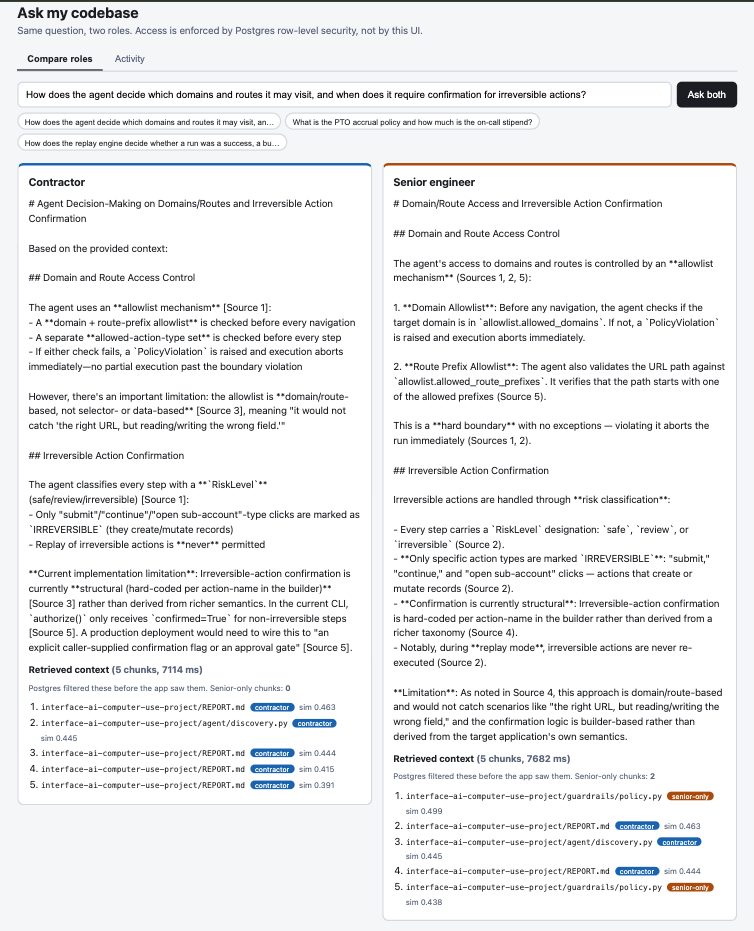
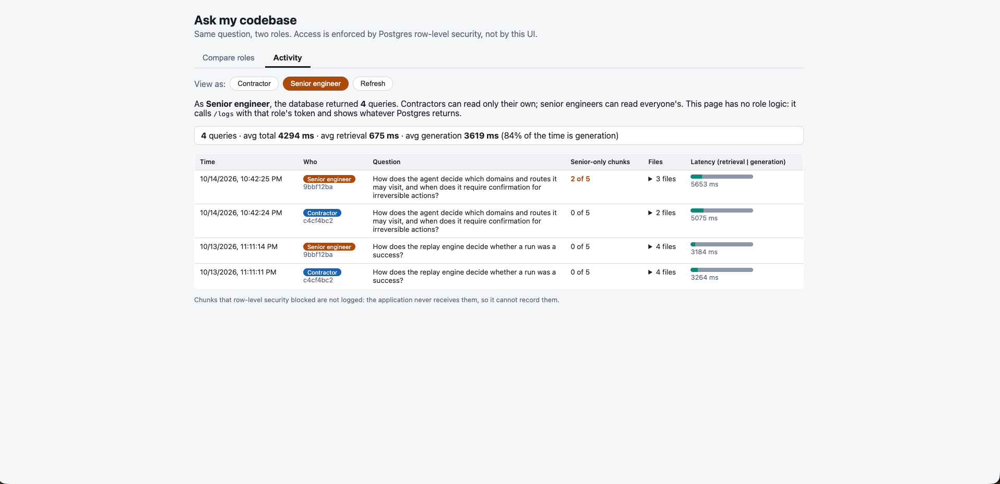

# RAG-ask-my-codebase

A "codebase Q&A" RAG assistant with role-based access control enforced at the
**database layer**, not the application layer or the UI.

## The problem

Engineers waste real time answering "how does X work here" questions across
unfamiliar codebases. An internal Q&A tool that retrieves from your own repos
solves that — but the moment a codebase has anything sensitive in it
(safety-critical logic, admin/billing internals, credentials-adjacent code),
naive RAG becomes a liability: anyone who can query the tool can retrieve
anything in the index, regardless of whether they should be able to see it.

Most RBAC implementations bolt access control onto the application layer —
an `if user.role == "admin"` check somewhere before returning results. That
works until someone adds a new code path that forgets the check. This project
asks a narrower, more defensible question: **can access control be enforced
at the database itself**, so no application code path can accidentally bypass
it?

## The approach

Two roles: `contractor` (restricted) and `senior_engineer` (full access).
Every chunk of code and documentation in the corpus is tagged with a
`required_scope`. Postgres **Row-Level Security (RLS)** — not a `WHERE`
clause written by hand in Python — decides which rows a given authenticated
user's query can see, at query time, in the database itself.

The retrieval function that powers `/ask` (`match_chunks`, a Postgres
function) is declared `SECURITY INVOKER`, not the `SECURITY DEFINER` default
shown in most Supabase examples. This one keyword is the entire security
model: `SECURITY DEFINER` runs a function with its *owner's* privileges,
which — for a function created by an admin-equivalent role — would silently
bypass RLS. `SECURITY INVOKER` runs it as the *calling user*, so the RLS
policy applies exactly as if that user ran a plain `SELECT` themselves.

Nowhere in the Python application code is there a manual scope filter. There
is no `if chunk.scope == "senior_engineer" and user.role != "senior_engineer": skip`.
The chunks that reach the FastAPI layer have already been filtered by
Postgres before they exist in memory — the database has already decided,
not the application.

## Demo

One question, asked as both roles at once. The contractor's retrieved context contains no
senior-only chunks; the senior engineer's does (orange badges). The access decision is made by
Postgres, not by the UI.



The Activity tab reads the query log through a single endpoint. The page has no role logic:
Postgres returns a contractor only their own queries and a senior engineer everyone's.



The UI runs locally; there is no deployed instance yet (Phase 3).

## Architecture

```
Client (with Supabase JWT)
    |
    v
FastAPI /ask endpoint
    |
    v
JWKS-based JWT verification (ES256) --> role lookup in user_roles
    |
    v
Supabase client scoped to THIS user's session (publishable key + their JWT)
    |
    v
match_chunks() Postgres RPC (SECURITY INVOKER)
    |
    v
RLS policy on `chunks` table filters rows -- enforced by Postgres, not Python
    |
    v
Only permitted chunks ever reach the app
    |
    v
Claude API generates an answer from ONLY those chunks
```

**Why the generation step has no scope awareness at all:** an LLM is not a
reliable access-control boundary — it can be prompted, confused, or simply
wrong about what it should or shouldn't say. The generation function receives
only chunks that have *already* passed through RLS. It doesn't know what a
"contractor" is. It cannot leak what it never received.

## Observability

Every `/ask` call is recorded in a `query_logs` table: the caller's role, the question, each
retrieved chunk (repo, path, scope, similarity) and retrieval, generation and total time.
Access to it is enforced the same way as for chunks (ADR 0007):

- a user can insert a row only about themselves, and the `role` column must match their real
  role in `user_roles`, so a contractor cannot claim to be senior
- a user can read their own rows; a senior engineer can read all rows
- nobody can update or delete rows, and `anon` has no access

The row is written by a background task after the response is sent, using the caller's own
user-scoped client, so these policies apply to the writer too; a logging failure is caught and
cannot break an answer. `GET /logs` returns whatever the caller's own client can read, with no
role check in the handler.

One limit worth stating: chunks that RLS blocked cannot be logged, because the application
never receives them.

## What's been verified, and how

The adversarial test suite (`tests/test_rbac_adversarial.py`) tests
`retrieve_chunks()` directly — not the HTTP endpoint, and not the final LLM
answer. This distinction matters: a test that only checks "did the model's
answer mention the restricted file" would pass even if the restricted chunk
was sitting in the model's context the whole time and the model just chose
not to repeat it. That's a much weaker guarantee than "the restricted chunk
was never retrieved in the first place." This suite proves the latter.

Covered:
- A contractor directly querying for known senior-only content, by close
  paraphrase of its exact wording — asserts zero senior-scoped chunks return.
- The same underlying topic asked indirectly, without naming the restricted
  file — a phrasing-based bypass attempt.
- The inverse: `senior_engineer` genuinely can retrieve that content (so the
  contractor tests aren't just passing because retrieval is broken for
  everyone).
- Cross-repo coverage: the same boundary holds against a second, unrelated
  repo's senior-only content (a different language, a different kind of
  sensitive material), not just one file that happens to work.
- A malformed/injection-style input to the retrieval RPC call, confirming
  Postgres's typed function signature rejects it at the type layer — there is
  no raw SQL string-building in this call path.
- A user authenticated via Supabase Auth but with no row in `user_roles` at
  all is rejected outright (403), rather than silently falling through to
  either role's access.
- A prompt-injection attempt embedded in the natural-language question itself
  does not expand retrieval beyond the caller's own RLS-permitted scope — the
  injection has no path to the database layer where enforcement happens.

All tests pass against the live corpus (~155 documents, ~2,716 chunks across
4 real repositories, 10 files marked senior-only).

## Test suite

42 tests, run with `python -m pytest -q` against the live database (a handful of them make real
Claude calls):

| Area | Tests | What they prove |
|---|---|---|
| RLS adversarial (`test_rbac_adversarial.py`) | 15 | restricted chunks are never retrieved, however the question is phrased |
| `/ask` endpoint (`test_ask_endpoint.py`) | 7 | auth wiring, response shape, and that a contractor is never cited a senior-only file |
| Role lookup (`test_auth_role_lookup.py`) | 3 | a failed lookup is a 503, zero rows a 403, a found role authenticates |
| Embedding concurrency (`test_embedding_concurrency.py`) | 2 | the CPU-pinned embedder is safe under threads (ADR 0006) |
| `query_logs` RLS (`test_query_logs_rls.py`) | 7 | insert, read, immutability and anon rules hold, tested as real users |
| Log writer (`test_query_log_writer.py`) | 3 | `/ask` records the caller's row; a failing writer cannot break an answer |
| `/logs` endpoint (`test_logs_endpoint.py`) | 5 | visibility sets, response shape, ordering, limit, authentication |

## What this project does and doesn't prove

There's an important distinction between two different claims, worth stating
explicitly rather than letting them blur together.

**RLS enforcement is wording-independent.** A contractor cannot retrieve a
senior-scoped chunk no matter how a question is phrased — the block happens
at the database row level, checked against `required_scope` on every
candidate row, after retrieval has already picked its candidates. It doesn't
matter whether the query is vague, exact, or guesses the right file name;
the enforcement doesn't look at wording at all.

**Retrieval quality is a separate, wording-dependent property.** Whether a
natural-language question successfully surfaces the *right* chunk in the
first place depends on how well the embedding model (`all-MiniLM-L6-v2`, a
small, free, local model) captures semantic similarity between a question
and a chunk's content. During Phase 2 evaluation, a real bug in this area was found and fixed. Early
in the project, a fictional lab-notes chunk failed to rank in the top 50 for
three paraphrases of its own content, and this was attributed to the embedding
model. That attribution was never isolated, and the eval showed a likelier
cause: an IVFFlat approximate-nearest-neighbor index (built before any data was
loaded, searched with the default `probes = 1`) returned only 2-4 candidates for
many real questions, so relevant chunks were never considered. The index was
dropped (migration 007, ADR 0005); at ~2.7k chunks an exact scan is cheap and
has full recall. On 28 hand-labeled questions at k=5, hit@5 went from 0.67 to
0.93 (contractor) and from 0.44 to 0.92 (senior engineer), with no change to the
embedding model, chunking, questions, or any access-control code. The original
three lab-notes paraphrases were not re-run, so whether they would now rank is
untested.

RLS enforcement and retrieval quality remain separate properties. The
adversarial suite's tests that need to confirm "can this role retrieve this known
chunk" still use the chunk's own exact embedding, which isolates the security
claim (RLS permits/denies correctly) from retrieval ranking. A zero-leak result
against a retriever that returns a few irrelevant chunks is weak evidence; after
the fix, the suite and the eval's leak check (0 leaks across 56 retrievals,
including contractor questions that ask directly about senior-only files) run
against a retriever that actually surfaces relevant content.

**The guarantee is about chunks, not facts.** RLS decides which chunks a user can retrieve; it
cannot decide what the contractor-visible chunks say. `REPORT.md` is classified `contractor`
(public-facing documentation), and it restates the guardrail mechanism at a high level: that an
allowlist, a confirmation rule and log redaction exist, and which functions enforce them. So a
contractor's answer can describe the mechanism in those terms even though `guardrails/policy.py`
itself is never retrieved for them, and the two-role demo shows exactly that: the contractor's
answer stays at the level of the report, while the senior's draws on the code. That follows from
the classification, not from a leak. Whether a document is safe to expose at that level of detail
is a classification judgment, the same unsolved problem described below, and not something RLS can
check. How much was verified: a keyword search of `REPORT.md` found mechanism descriptions and no
rule values (such as the actual allowed domains or redaction patterns), but the file was not read
in full.

**A related, more fundamental limitation**, worth stating outright: this
project's scope classifications (`docs/access_design.md`) were all made by
hand, by someone who already knows the corpus intimately. The system
enforces a given classification correctly and provably — it does not
determine what the classification should be. Applying this to an unfamiliar
codebase (a client's repo, an open-source project) is a genuinely harder,
unsolved problem, deliberately deferred to Phase 4 of this project's roadmap
rather than claimed as solved here.

## Retrieval quality: measured

Retrieval quality is measured separately from access control, on 28 hand-labeled
questions (`eval/`), run as both roles at k=5, the value `/ask` uses.

| Role (questions scored) | hit@5 | phrase@5 |
|---|---|---|
| contractor (15) | 0.93 | 0.73 |
| senior_engineer (25) | 0.92 | 0.72 |

- **hit@5**: a top-5 chunk comes from a file that answers the question.
- **phrase@5**: a top-5 chunk contains a specific answer-bearing phrase. Stricter,
  and a lower bound on true quality.
- **Access control under the eval:** 0 leaks across 56 retrievals (top 20 checked).
  On the 15 questions both roles are scored on, the two roles perform identically,
  so senior-only content does not crowd out relevant results for senior users.
- **What the eval found:** an approximate index was silently truncating results
  (ADR 0005); fixing it took hit@5 from 0.67 to 0.93 (contractor) and 0.44 to 0.92
  (senior), with nothing else changed.
- **Known weaknesses:** 500-character chunking fragments module docstrings, and the
  project's own docs outrank the code they restate. The top 20 contains the
  answer-bearing chunk for 23 of 25 senior questions, so reranking has headroom,
  but two questions need better candidate generation. Details, per-failure
  diagnosis and the k-sweep are in `docs/eval_baseline.md`.
- **Limits:** 28 questions (one question is worth 4-7 points), one author for the
  corpus, questions and labels, few paraphrased questions, and no evaluation of
  generated-answer quality.

Reproduce:

```bash
python -m scripts.validate_eval     # check the question set against the live DB
python -m scripts.eval_retrieval    # metrics + leak check (exit 1 on any leak)
python -m scripts.eval_sweep        # k = 3/5/10/20 and role comparison
python -m scripts.eval_inspect q003 # diagnose one question
```

## Stack, and why

| Choice | Reasoning |
|---|---|
| **FastAPI** | Matches typed, schema-driven backend patterns (Pydantic request/response contracts). |
| **Supabase (Postgres + pgvector + Supabase Auth)** | Chosen over Qdrant/FAISS specifically because Postgres RLS enforces access *in the database*, provably — not via an app-layer filter sitting near the vector search. |
| **all-MiniLM-L6-v2 embeddings (384-dim, local)** | Small, free, fast — appropriate for a corpus this size; precision tradeoffs are known and documented, not hidden. |
| **Supabase Auth, not hand-rolled JWT** | Deliberate: this project's differentiator is learning how Postgres RLS reads `auth.uid()` natively, not re-proving JWT implementation skills. |
| **JWKS/ES256 JWT verification** | Supabase's current signing scheme is asymmetric (ES256), not the HS256 shared-secret scheme most tutorials assume — verification fetches Supabase's public keys rather than trusting a static secret. |
| **claude-haiku-4-5 for generation** | Appropriate for a small, already-relevant 5-chunk context; not the same as a generation-quality decision that requires a bigger model. |

## Project status

**Phase 0 (corpus + access design + schema):** complete.
**Phase 1 (retrieval + RBAC enforcement):** complete, with the adversarial suite above.
**Phase 2 (eval, frontend, observability):** complete except a recorded demo. A 28-question
retrieval eval with a baseline and failure analysis (`docs/eval_baseline.md`), a side-by-side
two-role UI with citations, and RLS-protected query logs with an Activity tab.
**Phase 3 (CI/CD, Docker/deployment, hybrid search or reranking):** not started.

Architecture decisions are in `docs/adr/`. Two were found by running the system: an approximate
vector index that silently truncated results (0005) and a native crash under concurrent requests
(0006).

This README does not claim a deployed instance or a hosted demo; the UI runs locally.

## Running it locally

Backend:

```bash
python3 -m venv venv
source venv/bin/activate
pip install -r requirements.txt
```

Copy `.env.example` to `.env`, fill in your own Supabase project credentials and Anthropic API
key, and apply `db/migrations/` in order. Then:

```bash
uvicorn app.main:app
```

Frontend (Node 22.12 or newer, which Vite 8 requires):

```bash
cd frontend
npm install
cp .env.example .env.local   # fill in the Supabase URL, publishable key and the two demo users
npm run dev                  # http://localhost:5173, proxies /api to the backend on :8000
```

The UI signs in as two demo users, one per role, using the credentials in `frontend/.env.local`
(the same accounts the tests use). That is a demo harness: a deployed version would use a real
login. Only the publishable key is ever used in the browser.

Tests and the retrieval eval:

```bash
python -m pytest -q
python -m scripts.validate_eval
python -m scripts.eval_retrieval
```

`bash scripts/check.sh` runs all three and stops at the first failure.

## Security note on the corpus

Several "sensitive" files in the ingested corpus (e.g.
`nextplay_kanban/src/config/secrets_template.py`,
`brain-tumor-segmentation/internal/lab_notes.md`) are **deliberately fictional
fixtures** created for RBAC testing — clearly marked as such inside the files
themselves. No real credentials or genuinely private information exist in
this repository. Full classification reasoning for every file's scope is in
`docs/access_design.md`.

